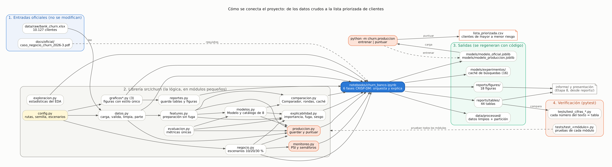

# Guía de archivos y ejecución. Proyecto final Analítica II (churn bancario)

Esta guía explica qué hace cada archivo del proyecto, por qué cumple lo que piden el caso (PDF oficial) y el profesor, y cómo dejarlo funcionando en VS Code y en GitHub, desde cero.

**En una frase:** el Excel crudo entra a una librería de Python (`src/churn/`), el notebook la usa para analizar, modelar y explicar, los resultados quedan en `reports/` y `models/`, y las pruebas (`tests/`) comprueban que todo, incluido cada número del texto, sea correcto.

---

## 1. Cómo se conecta todo



Cómo leerlo, de izquierda a derecha:

1. **Entradas oficiales:** el Excel y el PDF del caso. Nunca se modifican.
2. **Librería `src/churn/`:** toda la lógica, en módulos pequeños. `config.py` define rutas y parámetros; los demás módulos se usan entre sí sin repetir código.
3. **Notebook:** no tiene lógica propia; llama a la librería, muestra resultados y los interpreta.
4. **Salidas:** datos procesados, modelos, figuras y tablas. Se pueden borrar y regenerar con código.
5. **Verificación:** `pytest` prueba cada módulo y compara cada cifra citada en el notebook con las tablas guardadas.
6. **Uso fuera del notebook:** `python -m churn.produccion` entrena los modelos o puntúa un archivo de clientes nuevos, y `monitoreo.tabla_semaforos` calcula los indicadores de monitoreo de cada lote.

---

## 2. Qué hace cada archivo y por qué cumple

Las referencias entre paréntesis (R01, D14...) corresponden a la lista de requisitos del equipo, donde cada requisito tiene su fuente: el PDF oficial del caso, las indicaciones del profesor o una decisión del equipo.

### 2.1 Raíz del proyecto

| Archivo | Qué hace | Por qué cumple |
|---|---|---|
| `README.md` | Explica el proyecto, cómo instalarlo, cómo correr el notebook y cómo usar el modelo | El profesor pide que el proyecto se entienda y se pueda ejecutar sin explicaciones adicionales (R14, R21) |
| `requirements.txt` | Lista de librerías con versiones fijas y probadas en Python 3.11 | Garantiza que los dos computadores obtengan los mismos resultados (D03) |
| `pyproject.toml` | Convierte `src/churn/` en una librería instalable con `pip install -e .` | El profesor pidió el proyecto "como una librería", no como un notebook suelto (R22) |
| `.gitignore` | Le dice a Git qué no subir: entorno, datos procesados, modelos, originales de la raíz y credenciales | Repositorio privado sin datos innecesarios ni sensibles (D04) |
| `bank_churn Dataset Juanfer y Juandi.xlsx` y `Caso de Negocio - Churn - 2026-3 - Juanfer y Juandi.pdf` | Originales del semestre, intactos | Se conservan como respaldo; el trabajo usa copias verificadas (D01) |

### 2.2 Datos y documentación

| Archivo | Qué hace | Por qué cumple |
|---|---|---|
| `data/raw/bank_churn.xlsx` | Copia de trabajo del Excel (idéntica al original, verificada con SHA-256) | El profesor pide separar datos crudos de procesados (R15) |
| `data/processed/bank_churn_limpio.csv` y `particion.csv` | Datos limpios y la asignación fija de cada cliente a train o test | Todos los análisis usan los mismos clientes de prueba; se regeneran con código (R15) |
| `docs/oficial/caso_negocio_churn_2026-3.pdf` | Copia de trabajo del enunciado oficial | Fuente de los requisitos del caso |
| `docs/GUIA_ARCHIVOS_Y_EJECUCION.md` y `docs/diagrama_proyecto.png` | Esta guía y su diagrama | Explicación de la estructura para el equipo y para el profesor (R21) |

### 2.3 Librería `src/churn/` (la lógica del proyecto)

| Archivo | Qué hace | Por qué cumple |
|---|---|---|
| `__init__.py` | Marca la carpeta como paquete de Python | Necesario para importar `from churn import ...` |
| `config.py` | Rutas relativas, semilla 42, tamaño del test, 5 pliegues y escenarios de 10, 20 y 30 % rotulados como supuestos | Sin rutas del tipo `C:\Users\...`: corre igual en cualquier computador (D02, D07) |
| `datos.py` | Carga el Excel, lo valida (26 chequeos: columnas, vacíos, duplicados, categorías, rangos, identidades contables), lo limpia y lo parte 80/20 de forma aleatoria y estratificada | Datos confiables antes de modelar; el test queda reservado (D09, D17) |
| `exploracion.py` | EDA automático de train (`ydata-profiling`, 2.2 del notebook) y cálculos del EDA dirigido: tasas por grupo con intervalo de Wilson, asociación entre variables y tramos (los de monto se definen una sola vez y los reutiliza la explicabilidad) | Cada gráfico del EDA termina en una decisión, como pide el profesor (D18) |
| `features.py` | Preparación dentro de un `Pipeline`: crea variables, codifica categorías y transforma numéricas, ajustándose solo con train | Evita fuga de información (que el modelo "vea" el test antes de tiempo) (D20) |
| `modelos.py` | Clase `Modelo` y catálogo de 10 modelos (los métodos de clasificación del curso): pipeline, grilla, GridSearchCV con 5 pliegues, manejo del desbalance y elección por parsimonia | Programación orientada a objetos, sin copiar y pegar: agregar un modelo cuesta una línea (R16, R23) |
| `comparacion.py` | Clase `Comparador`: variables candidatas, comparación con los mismos pliegues, selección de variables por modelo, rondas de ampliación de grillas, efecto de cada kernel y activación, votación y stacking de finalistas, caché con huella digital y exploración con PyCaret | Separa lo que se hace con un modelo de lo que se hace con varios; evita repetir cerca de una hora de cálculo (R23, R24, D24) |
| `evaluacion.py` | Una sola función de métricas para todos los modelos, predicciones fuera de pliegue, bootstrap y calibración | Mismas métricas y mismos umbrales para todos; corrige errores del trabajo de referencia (D10, D25, D26) |
| `negocio.py` | Escenarios de contacto, captura, precisión, lift, precisión marginal y cortes de la regla económica (s · r mínimo por tramo) | Traduce el modelo a la pregunta del caso: a qué clientes dar beneficios primero (R12, D11) |
| `explicabilidad.py` | Importancia de variables, dependencia parcial, sensibilidad a fuga y sesgo, y trato por sexo y por edad (contacto, captura, precisión y proporcionalidad al riesgo por grupo) | Explica en qué se apoya el modelo y acota sus riesgos (R25, D12) |
| `produccion.py` | Guarda el modelo oficial con su ficha, valida datos nuevos, puntúa clientes y ofrece la línea de comandos | Modelo viable que se usa fuera del notebook, como exige el profesor (R12, D14, D27 a D29) |
| `monitoreo.py` | PSI por variable, PSI del puntaje y captura frente a la línea base, con semáforo, y la tabla `tabla_semaforos` que los reúne por lote | Monitoreo y control de CRISP-DM que pide el PDF (R13) |
| `reportes.py` | Una sola forma de guardar tablas y figuras desde el notebook | Evita repetir el mismo código en cada celda (R16) |
| `graficos.py`, `graficos_modelado.py` y `graficos_negocio.py` | Las figuras del EDA, del modelado y la evaluación, y de negocio y explicabilidad, con un estilo único, apto para daltonismo y con formato numérico en español | Figuras consistentes y listas para el informe (R06) |
| `entorno.py` y `reparar_entorno.py` | Solo para Windows: detectan y reparan el choque entre la librería de C++ que trae scikit-learn y la que necesita LightGBM (ver paso 6) | Que el proyecto corra igual en Windows que en Linux sin cambiar versiones ni resultados (D03) |

### 2.4 Notebook, resultados y modelos

| Archivo | Qué hace | Por qué cumple |
|---|---|---|
| `notebooks/churn_banco.ipynb` | Las 6 fases de CRISP-DM: negocio (Fase 1), datos y EDA (Fase 2), preparación (Fase 3), modelado (Fase 4), evaluación en test, negocio, explicabilidad, equidad, riesgos y conclusiones (Fase 5), y modelo viable, uso y monitoreo (Fase 6). Cada subsección explica qué hace, ejecuta y termina en una lectura y una decisión | El PDF exige un notebook que soporte los resultados (R02) y el ciclo CRISP-DM con monitoreo y control (R13) |
| `reports/figures/*.png` (16) | Figuras del EDA, modelado, test, negocio y explicabilidad | Insumo directo del informe (R06 a R09) |
| `reports/perfil_train.html` | Reporte del EDA automático de train (2.2) | El barrido completo; el EDA dirigido (2.3 a 2.8) solo profundiza donde hay relación con el churn o riesgo |
| `reports/tables/*.csv` (39) | Tablas con cada número que cita el notebook | Insumo del informe y base de las pruebas de cifras (D13, D19) |
| `models/experimentos/*.joblib` (19) | Caché de las búsquedas de hiperparámetros, una por modelo y ronda | Evita repetir cerca de una hora de cálculo; se reentrena solo lo que cambió (D24) |
| `models/modelo_oficial.joblib` | LightGBM elegido en la Fase 4: **el modelo evaluado en test y el que puntúa clientes** | Resultado oficial del proyecto y modelo viable |

### 2.5 Pruebas automáticas `tests/`

| Archivo | Qué comprueba |
|---|---|
| `test_datos.py` | Que la validación detecte datos rotos y que la partición sea estratificada y reproducible |
| `test_exploracion.py` | Los cálculos del EDA (intervalos, tasas, tramos) y el EDA automático |
| `test_features.py` | Que la preparación no tenga fuga y funcione dentro de la validación cruzada |
| `test_modelos.py` | El catálogo, la elección con parsimonia, la detección de bordes y la caché |
| `test_evaluacion.py` | Las métricas (sensibilidad, especificidad, AUC) con casos calculados a mano |
| `test_negocio.py` | Los escenarios, la precisión marginal y los cortes de la regla económica |
| `test_explicabilidad.py` | La importancia, la neutralización de variables y la tabla de trato por grupo (contacto proporcional al riesgo) |
| `test_monitoreo.py` | Que el PSI y los semáforos detecten cambios sin dar falsas alarmas, y la tabla de semáforos por lote |
| `test_reportes.py` y `test_extracciones.py` | El guardado de tablas y figuras y las funciones pequeñas que usa el notebook |
| `test_referencias.py` | Que el código, el README y esta guía citen las fases del notebook y no la numeración anterior |
| `test_produccion.py` | Que el modelo rechace datos inválidos, use la clase `Attrited Customer`, ordene bien y se reconstruya idéntico |
| `test_entorno.py` | Que la revisión de Windows detecte el choque de DLL, lo repare con respaldo y que LightGBM entrene |
| `test_cifras_texto.py` | Lee el notebook y exige que **cada número del texto** aparezca en una salida del código o en una tabla de `reports/tables/`; además comprueba que las decisiones escritas se cumplen en las tablas |
| `test_cifras_datos.py`, `test_cifras_eda.py`, `test_cifras_preparacion.py`, `test_cifras_modelado.py` y `conftest.py` | Recalculan por otra vía las cifras de los datos, el EDA y la preparación, y comprueban que las tablas de modelado salen de los modelos guardados en la caché |

Por qué importa: el profesor evalúa el código y los resultados. Las pruebas garantizan que lo que dice el informe es exactamente lo que produce el código (D13).

---

## 3. Paso a paso: del computador vacío al proyecto funcionando

Cada paso dice qué hacer y qué deberías ver. Si algo no coincide, revisa el apartado 4 (Problemas frecuentes).

### Paso 0. Antes de empezar

- Computador con Windows, conexión a internet y unos 3 GB libres.
- Una cuenta de GitHub para cada uno (https://github.com).
- La carpeta `Trabajo Juanfer & Juandi` en tu computador (Juandi la obtendrá desde GitHub en el paso 14).

### Paso 1. Instalar Python 3.11

1. Descarga el instalador de Python 3.11 para Windows (64 bits) desde https://www.python.org/downloads/windows/. Debe ser **3.11**, no 3.12 ni 3.13: PyCaret no funciona en versiones superiores.
2. En el instalador marca **"Add python.exe to PATH"** y deja marcado **"py launcher"**. Luego, "Install Now".
3. Abre PowerShell y verifica:

```powershell
py -3.11 --version
```

Deberías ver `Python 3.11.x`.

### Paso 2. Instalar Git y VS Code

1. Git para Windows: https://git-scm.com/download/win (opciones por defecto).
2. VS Code: https://code.visualstudio.com.
3. En VS Code, menú de extensiones (Ctrl+Shift+X), instala **Python** y **Jupyter** (ambas de Microsoft).
4. Configura tu nombre en Git (una sola vez):

```powershell
git config --global user.name "Tu Nombre"
git config --global user.email "tu_correo@ejemplo.com"
```

### Paso 3. Abrir el proyecto

1. En VS Code: **File > Open Folder** y elige la carpeta `Trabajo Juanfer & Juandi`.
2. Abre una terminal: **Terminal > New Terminal**. Debe ser PowerShell y estar ubicada en la carpeta del proyecto.

### Paso 4. Crear el entorno virtual

El entorno virtual es una instalación de Python solo para este proyecto, para que sus librerías no choquen con otras.

```powershell
py -3.11 -m venv .venv
.venv\Scripts\activate
python --version
```

Deberías ver `(.venv)` al inicio de la línea y `Python 3.11.x`.

> Si aparece un error de "ejecución de scripts deshabilitada", ejecuta una vez
> `Set-ExecutionPolicy -Scope CurrentUser RemoteSigned`, responde `S` y repite `.venv\Scripts\activate`.

### Paso 5. Instalar las librerías y el proyecto

```powershell
python -m pip install --upgrade pip
pip install -r requirements.txt
pip install -e .
```

Tarda entre 5 y 10 minutos. **Si el entorno ya existía, repite `pip install -r requirements.txt`:** la versión actual agrega `ydata-profiling` (EDA automático de 2.2), `six` y `setuptools<81`, y sin ellas el notebook falla en 2.2. El último comando instala `src/churn/` como librería; termina con `Successfully installed churn-...`.

### Paso 6. Solo en Windows: reparar el choque de LightGBM

**Por qué.** scikit-learn 1.4.2 trae su propia copia de una librería de Microsoft para C++ (`msvcp140.dll`, versión 14.32) y la carga primero. LightGBM 4.7.0 fue compilado con una versión más nueva (14.44) y necesita 14.40 o superior. Como Windows reutiliza la copia ya cargada, LightGBM falla al entrenar con `OSError: exception: access violation reading 0x0000000000000000`. En Linux no pasa. La reparación no cambia ninguna versión ni ningún resultado.

1. Instala o actualiza el **Microsoft Visual C++ Redistributable 2015-2022 (x64)**: https://aka.ms/vs/17/release/vc_redist.x64.exe (si dice que ya está instalado, elige "Reparar" o ciérralo).
2. Cierra cualquier notebook abierto (o reinicia VS Code) y, en una terminal nueva con `(.venv)` activo:

```powershell
python -m churn.reparar_entorno --reparar
```

Deberías ver `Choque detectado: sí`, las dos DLL reemplazadas (por ejemplo `msvcp140.dll: 14.32... -> 14.44...`, con respaldo `.original`) y al final `Prueba de LightGBM después de importar scikit-learn: OK`.

3. Para comprobar después: `python -m churn.reparar_entorno` debe decir `Choque detectado: no` y `OK`.

> Hay que repetirlo cada vez que se cree un `.venv` nuevo (por ejemplo, en el computador de Juandi). Si el entorno tiene el problema, el proyecto lo avisa al importarse con un mensaje que trae este mismo comando.

### Paso 7. Elegir el intérprete en VS Code

Ctrl+Shift+P, escribe **Python: Select Interpreter** y elige el que dice `.venv` (Python 3.11).

### Paso 8. Generar los datos procesados

```powershell
python -c "from churn import datos; datos.preparar_datos(); print('ok')"
```

Debe imprimir `ok` y crear o actualizar `data/processed/`. Es obligatorio después de clonar desde GitHub, porque esa carpeta no se sube.

### Paso 9. Correr las pruebas

```powershell
pytest
```

Resultado esperado: ninguna prueba en `failed`. Si el notebook todavía no se ha ejecutado en ese computador, varias pruebas de cifras aparecen como `skipped` (omitidas): es normal, porque esperan las tablas de `reports/tables/`. Pueden aparecer avisos (`warnings`); no son errores. Tarda alrededor de un minuto.

### Paso 10. Ejecutar el notebook de punta a punta

1. Abre `notebooks/churn_banco.ipynb`.
2. Arriba a la derecha, **Select Kernel > Python Environments > .venv (Python 3.11)**.
3. Pulsa **Restart**, luego **Run All**.
4. Tiempo: unos 20 minutos si `models/experimentos/` tiene la caché del 13-nov, y cerca de una hora y media si no la tiene (vuelve a hacer las búsquedas).

Qué verificar al terminar:

- Ninguna celda con error en rojo.
- 2.1: "Chequeos superados: 26 de 26".
- 4.7: finalistas LightGBM, Gradient Boosting y XGBoost.
- 5.1: AUC de LightGBM en test de 0,9930.
- 6.1: la tabla de validaciones del modelo viable con todos los valores en `True`.

### Paso 11. Probar el modelo fuera del notebook

```powershell
python -m churn.produccion puntuar data\raw\bank_churn.xlsx "$env:TEMP\lista_prueba.csv" --capacidad 0.2
```

Debe imprimir `10127 clientes puntuados con LightGBM (modelo oficial)`. Antes aparece un aviso (`UserWarning`) de 4 valores fuera del rango de train: es esperado, porque el archivo completo incluye clientes que el modelo no vio al entrenar, y es la función avisando que en esos casos extrapola. El archivo queda en la carpeta temporal de Windows (no en el proyecto) y trae a los clientes ordenados de mayor a menor riesgo, con `contactar = True` para el 20 % de mayor riesgo. Es solo una prueba de funcionamiento: no es una evaluación del modelo.

Si los archivos `models/*.joblib` no existen, primero ejecuta `python -m churn.produccion entrenar` (tarda segundos).

### Paso 12. Volver a correr las pruebas

```powershell
pytest
```

Ahora no debe quedar ninguna prueba en `failed` ni en `skipped`: confirma que las tablas que generó tu ejecución coinciden con los números del texto.

### Paso 13. Subir el proyecto a GitHub (lo hace uno de los dos)

1. En GitHub: **New repository**, nombre por ejemplo `churn-analitica-ii`, **Private**, y **sin** README, sin .gitignore y sin licencia (el proyecto ya los tiene).
2. En la terminal de VS Code, dentro del proyecto:

```powershell
git init
git status
```

3. **Revisa la lista antes de seguir.** NO deben aparecer `.venv/`, `models/`, `data/processed/*.csv` ni los dos archivos originales de la raíz (`bank_churn Dataset...xlsx` y `Caso de Negocio...pdf`). Sí deben aparecer `src/`, `tests/`, `notebooks/`, `docs/`, `reports/`, `data/raw/` y los archivos de configuración.
4. Primer commit y subida (cambia la URL por la de tu repositorio):

```powershell
git add .
git commit -m "Proyecto final churn: librería, notebook, pruebas y modelo viable"
git branch -M main
git remote add origin https://github.com/TU_USUARIO/churn-analitica-ii.git
git push -u origin main
```

La primera vez se abre el navegador para iniciar sesión en GitHub.

### Paso 14. Invitar al compañero

En el repositorio: **Settings > Collaborators > Add people**, escribe el usuario de GitHub de Juandi. Él debe aceptar la invitación desde su correo.

### Paso 15. El compañero descarga y ejecuta el proyecto

En su computador, después de los pasos 1 y 2:

```powershell
git clone https://github.com/TU_USUARIO/churn-analitica-ii.git
cd churn-analitica-ii
code .
```

Luego repite los **pasos 4 a 10** (incluido el paso 6 si usa Windows). La caché (`models/experimentos/`) y los modelos no están en GitHub. Hay tres opciones:

- **Rápida:** copiar la carpeta `models/experimentos/` del computador de Juanfer (USB, OneDrive o Drive) a la misma ruta. El notebook tarda unos 20 minutos y da exactamente las cifras del texto.
- **Completa:** correr el notebook sin caché; tarda cerca de una hora y media. LightGBM da lo mismo; XGBoost y Gradient Boosting pueden cambiar en la cuarta decimal, y `test_cifras_texto.py` lo señala.
- **Solo para usar el modelo:** `python -m churn.produccion entrenar` crea el `.joblib` en segundos.

### Paso 16. Trabajo diario en equipo

```powershell
git pull                      # antes de empezar: traer los cambios del compañero
pytest                        # después de cambiar código
git add .
git commit -m "Qué cambió y por qué"
git push                      # al terminar
```

Reglas para no chocar: solo una persona edita el notebook a la vez (Git no combina bien los notebooks) y nunca se sube `.venv` ni la caché.

### Último paso. Lista de verificación final

- [ ] `py -3.11 --version` muestra 3.11 en los dos computadores.
- [ ] `python -m churn.reparar_entorno` dice `OK` en los dos computadores.
- [ ] `pytest` no muestra pruebas en `failed` en los dos computadores (y ninguna `skipped` después de ejecutar el notebook).
- [ ] El notebook corre con Run All sin errores y la tabla de validaciones de 6.1 está toda en `True`.
- [ ] `python -m churn.produccion puntuar ...` genera la lista priorizada.
- [ ] El repositorio privado existe, los dos tienen acceso y `git status` no muestra archivos pendientes.
- [ ] Pendiente para cerrar el proyecto: el informe (Etapa 8) y la presentación.

---

## 4. Problemas frecuentes

| Síntoma | Causa probable | Solución |
|---|---|---|
| `py` no se reconoce | Python no quedó en el PATH | Reinstala Python 3.11 marcando "Add python.exe to PATH" |
| Error al activar `.venv` | Política de ejecución de PowerShell | `Set-ExecutionPolicy -Scope CurrentUser RemoteSigned` |
| Falla `pip install pycaret` | Versión de Python distinta de 3.11 | Borra `.venv` y créalo con `py -3.11 -m venv .venv` |
| `ModuleNotFoundError: No module named 'churn'` | Falta instalar la librería o el kernel no es `.venv` | `pip install -e .` y elige el kernel `.venv` |
| Muchas pruebas fallan con "No such file" en `data/processed` | No se generaron los datos procesados | Paso 8 |
| `OSError: exception: access violation reading 0x0000000000000000` al entrenar LightGBM (notebook o `test_produccion.py`) | Choque entre la `msvcp140.dll` vieja de scikit-learn y LightGBM | Paso 6 |
| `python -m churn.reparar_entorno --reparar` dice que el archivo está en uso | Un kernel de Jupyter tiene cargada la DLL | Cierra VS Code y ejecuta el comando en una terminal nueva |
| La reparación dice que la DLL de Windows también es vieja | Falta actualizar el Visual C++ Redistributable | Instálalo (paso 6.1) y repite |
| El notebook tarda mucho en la Fase 4 | No está la caché de búsquedas | Copia `models/experimentos/` o espera cerca de una hora y media |
| `test_cifras_texto` falla con una lista de cifras | El texto cita un número que no está en las salidas de esta ejecución (por ejemplo, una cifra de XGBoost o Gradient Boosting, que cambian entre computadores) | Corregir esa cifra en el texto con el valor de la salida |
| `git push` pide usuario y contraseña | Falta iniciar sesión | Usa la ventana del navegador que abre Git o GitHub Desktop |
